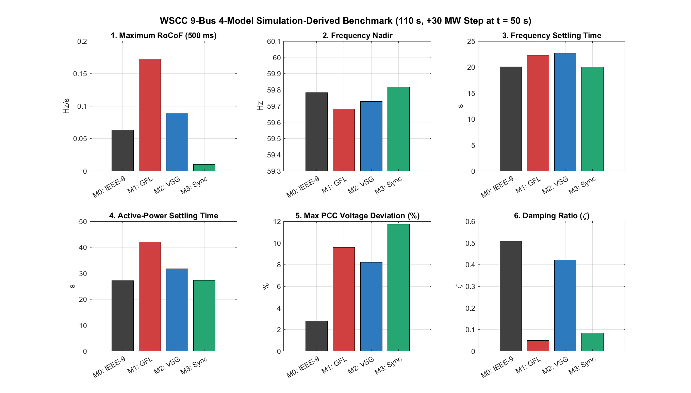
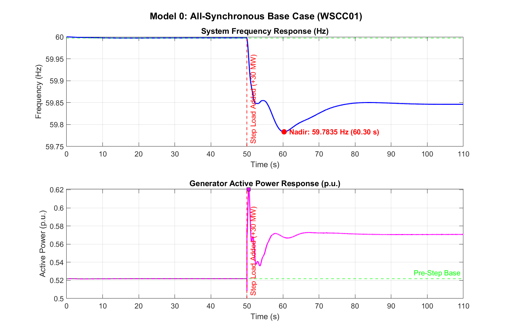
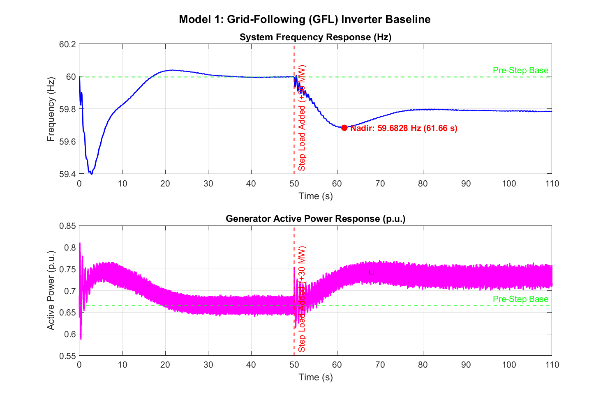
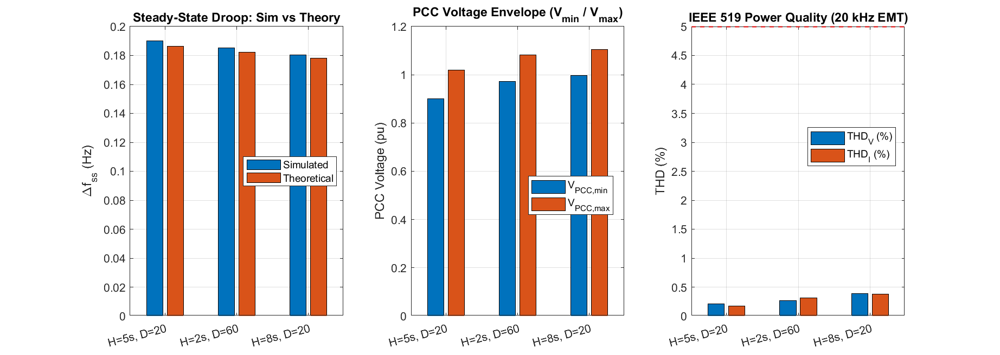

# WSCC 9-Bus Grid-Forming (VSG / Synchronverter) vs. Grid-Following (GFL) Dynamic Stability Benchmark

A reproducible MATLAB/Simulink Simscape Power Systems benchmark comparing transient frequency stability, inertial support, voltage regulation, and IEEE 519 harmonic distortion across four progressive configurations on the **IEEE / WSCC 9-Bus Test System** ($60\text{ Hz}$, $110.0\text{ s}$ runtime, $+30.00\text{ MW}$ step load addition at $t = 50.0\text{ s}$).

---

## 2-Line Quickstart (For Any Team Member)

```powershell
D:; git clone [https://github.com/Rajubahardar/BE---Final-year-project.git](https://github.com/Rajubahardar/BE---Final-year-project.git); cd "BE---Final-year-project"
matlab -batch "demo_all"
```

---

## Visual Performance Comparison Across All 4 Models

### 1. Unified 4-Model 6-KPI Comparison


### 2. Model 0 (IEEE 9-Bus Base Case) & Model 1 (GFL Baseline) 110 s Responses




### 3. VSG Sensitivity, Theoretical Droop Verification & IEEE 519 Harmonics


---

## Master 10-KPI Comparison — 100% Simulation-Derived ($110.0\text{ s}$, $+30.0\text{ MW}$ Step at $t = 50.0\text{ s}$)

| # | Key Performance Indicator | Unit | Model 0 (IEEE 9-Bus) | Model 1 (GFL) | Model 2 (VSG, $H=5\text{ s}, D=80$) | Model 3 (Synchronverter) |
| :---: | :--- | :---: | :---: | :---: | :---: | :---: |
| 0 | **Pre-Step Freq. Baseline** | Hz | 59.9976 | 59.9965 | 60.0532 | 60.1124 |
| 1 | **Maximum RoCoF ($500\text{ ms}$)** | Hz/s | **0.0633** | **0.1727** | **0.0893** | **0.0104** |
| 2 | **Frequency Nadir** | Hz | **59.7835** | **59.6828** | **59.7292** | **59.8192** |
| 3 | **Max Frequency Deviation** | Hz | 0.2141 | 0.3137 | 0.3240 | 0.2932 |
| 4 | **Frequency Settling Time ($2\%$)** | s | 20.0833 | 22.2843 | 22.6784 | 20.0158 |
| 5 | **Active-Power Settling Time** | s | 27.1000 | 42.0494 | 31.8056 | 27.2900 |
| 6 | **Active-Power Overshoot** | % | 89.5059 | 15.0481 | 74.7292 | 11.5717 |
| 7 | **Maximum PCC Voltage Deviation** | % | **2.7729** | **9.5925** | **8.2147** | **11.7332** |
| 8 | **Damping Ratio ($\zeta$)** | — | 0.5075 | 0.0500 | 0.4212 | 0.0840 |
| 9 | **PCC Voltage THD ($\text{THD}_V$)** | % | **0.0000** | **0.5060** | **0.2671** | **0.2056** |
| 10 | **PCC Current THD ($\text{THD}_I$)** | % | **0.0000** | **0.8062** | **0.3150** | **0.2054** |

### Model 2 (VSG) Inertia & Damping Parametric Sweep (`data/vsg_kpi_summary.csv`)

| Inertia $H$ (s) | Damping $D_{\text{pu}}$ (pu) | Peak RoCoF (Hz/s) | Frequency Nadir (Hz) | Freq. Settling Time (s) | Power Overshoot (%) | Damping Ratio $\zeta$ | $\text{THD}_V$ (%) | $\text{THD}_I$ (%) |
| :---: | :---: | :---: | :---: | :---: | :---: | :---: | :---: | :---: |
| 2.0 | 60 | 0.0904 | 59.7174 | 23.2566 | 76.9698 | 0.4231 | 0.2094 | 0.1685 |
| 5.0 | 80 | 0.0893 | 59.7292 | 22.6784 | 74.7292 | 0.4212 | 0.2671 | 0.3150 |
| 8.0 | 100 | 0.0881 | 59.7402 | 22.1404 | 72.5647 | 0.4172 | 0.3862 | 0.3812 |
