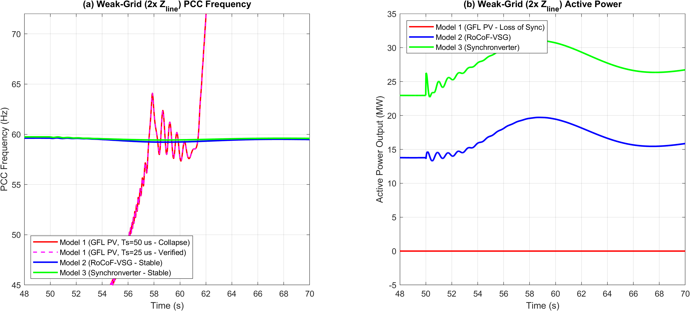

# Multi-Domain Transient & Grid-Forming Control Benchmark on the WSCC 9-Bus System

[](https://www.mathworks.com/)
[-2E7D32)](#system-architecture--models)
[](#reproducibility--quick-start)
[%20Sweep-E65100)](#benchmark-results-s1s4)

A reproducible multi-domain electromagnetic transient (EMT) and phasor-domain benchmark comparing **Grid-Following (GFL)** and **Grid-Forming (GFM)** inverter topologies against a conventional synchronous-generator baseline on the standard **WSCC 9-bus** network. The suite evaluates four operating contingencies (`S1`–`S4`)—including weak-grid loss-of-synchronism verification across solver timesteps ($50\ \mu\text{s}$ vs. $25\ \mu\text{s}$)—and a **32-point decoupled $(H, D)$ sensitivity sweep**.

---

## Key Highlights

- **Grid-Forming Stability Across All Contingencies (`S1`–`S4`):** While `Model 1` (GFL PV) loses synchronism in both the weak-grid (`S3`: $\Delta f_{\max} = 12.98\text{ Hz}$, $283.6\text{ MW}$ surge) and high-RES (`S4`: frequency collapse to $33.04\text{ Hz}$, $533.9\text{ MW}$ surge) scenarios, both GFM topologies (`Model 2` RoCoF-VSG and `Model 3` Synchronverter) remain stable across all four contingencies.
- **High-RES Frequency Regulation (`S4`, $100\text{ MVA}$ Base):** At high renewable penetration, `Model 2` (RoCoF-VSG) outperforms the conventional `Model 0` (All-SG) baseline—cutting maximum frequency deviation by **41.7%** ($0.1248$ vs. $0.2141\text{ Hz}$) and settling **42.8% faster** ($9.99$ vs. $17.48\text{ s}$) with $\zeta = 0.3621$.
- **Baseline Load-Step & Load-Shed Performance (`S1`, `S2`):** In `S1`, `Model 2` reduces 500 ms RoCoF by **18.5%** ($0.1399$ vs. $0.1715\text{ Hz/s}$) and peak power surge by **54.9%** ($4.73$ vs. $10.50\text{ MW}$) relative to `Model 1`, while `Model 3` achieves the fastest settling time in both `S1` (**14.50 s**) and `S2` (**19.08 s**).
- **Power Quality Compliance:** Across all four scenarios, both GFM EMT models remain well within IEEE 519 harmonic limits ($\text{THD}_v \le 1.13\%$, $\text{THD}_i \le 0.85\%$).

---

## System Architecture & Models

| Model | Topology | Simulation Domain | Base Power ($S_{\text{rated}}$) | Primary Control Role |
| :--- | :--- | :--- | :---: | :--- |
| **Model 0** | All-Synchronous Generators (Baseline) | Phasor | $100\text{ MVA}$ (Gen G1 base) | Reference electromechanical inertia & governor response |
| **Model 1** | Grid-Following (GFL) PV Inverter | Hybrid EMT / Phasor | $11\text{ MVA}$ ($100\text{ MVA}$ in `S4`) | PLL-synchronized current-controlled PQ injection |
| **Model 2** | RoCoF-Compensated VSG (GFM) | Hybrid EMT / Phasor | $11\text{ MVA}$ ($100\text{ MVA}$ in `S4`) | Virtual swing equation + RoCoF feedforward + inner LCL double-loop |
| **Model 3** | Synchronverter (GFM) | Hybrid EMT / Phasor | $11\text{ MVA}$ ($100\text{ MVA}$ in `S4`) | Direct synchronous-machine stator/rotor electromagnetic emulation |

---

## Contingency Scenarios (`S1`–`S4`)

| Scenario ID | Disturbance Event ($t = 50\text{ s}$) | Network / Rating Condition | Primary Stress Tested |
| :--- | :--- | :--- | :--- |
| **`S1_LoadStep_30MW`** | $+30\text{ MW}$ load step | Nominal grid, $S_{\text{rated}} = 11\text{ MVA}$ (inverters) | Baseline inertial arrest, nadir, and active-power surge |
| **`S2_LoadShed_45MW`** | $-45\text{ MW}$ load shedding | Nominal grid, $S_{\text{rated}} = 11\text{ MVA}$ (inverters) | Over-frequency arrest, reverse power absorption, voltage rise |
| **`S3_WeakGrid_30MW`** | $+30\text{ MW}$ load step | Weak grid ($2\times Z_{\text{line}}$), $S_{\text{rated}} = 11\text{ MVA}$ | Low-SCR synchronization stability ($50\ \mu\text{s}$ vs. $25\ \mu\text{s}$ verified) |
| **`S4_HighRES_100MVA`** | $+30\text{ MW}$ load step | High-RES scale, $S_{\text{rated}} = 100\text{ MVA}$ (inverters) | High-penetration frequency support and large-signal stability |

---

## Visual Results

### 1. Multi-Scenario Performance Comparison (`S1`–`S4`)

*Cross-contingency comparison of frequency dynamics, active-power surge, and transient margins across `Model 0`–`Model 3`.*

### 2. Weak-Grid Loss of Synchronism & Timestep Verification (`S3`, $2\times Z_{\text{line}}$)

*Time-domain PCC frequency and active-power trajectories under weak-grid conditions. `Model 1` (GFL PV) collapses identically at $T_s = 50\ \mu\text{s}$ and $T_s = 25\ \mu\text{s}$, whereas `Model 2` (RoCoF-VSG) and `Model 3` (Synchronverter) maintain stable synchronization.*

### 3. Decoupled $(H, D)$ Parameter Sensitivity Sweep

*32-point parametric map isolating the independent impact of virtual inertia constant $H$ and damping coefficient $D_{\text{pu}}$ on RoCoF, frequency nadir, settling time, and damping ratio $\zeta$.*

---

## Benchmark Results (`S1`–`S4`)

Full contingency metrics exported from [`results/reviewer_fixed_all_scenarios.csv`](results/reviewer_fixed_all_scenarios.csv):

| Scenario | Model | Status | $\text{RoCoF}_{500\text{ms}}$ (Hz/s) | $f_{\text{ext}}$ (Hz) | $\lvert \Delta f_{\max} \rvert$ (Hz) | $t_{s,f}$ (s) | $\Delta P_{\text{peak}}$ (MW) | $\Delta P / S_{\text{rated}}$ (%) | $\zeta$ | $\text{THD}_v$ / $\text{THD}_i$ (%) |
| :--- | :--- | :---: | :---: | :---: | :---: | :---: | :---: | :---: | :---: | :---: |
| **`S1`** (+30 MW) | Model 0 (All-SG) | Stable | 0.1151 | 59.7835 | 0.2141 | 17.48 | 9.87 | 9.87 | 1.0000 | 0.00 / 0.00 |
| | Model 1 (GFL PV) | Stable | 0.1715 | 59.7076 | 0.3111 | 19.60 | 10.50 | 95.44 | 0.2620 | — |
| | Model 2 (RoCoF-VSG) | Stable | **0.1399** | 59.6778 | 0.3212 | 15.08 | **4.73** | **43.01** | 0.0526 | 0.20 / 0.23 |
| | Model 3 (Synchronverter) | Stable | 0.1605 | **59.7661** | **0.2825** | **14.50** | 7.54 | 68.59 | 0.1296 | 0.30 / 0.33 |
| **`S2`** (-45 MW) | Model 0 (All-SG) | Stable | 0.1734 | 60.0906 | 0.3191 | 18.96 | 14.82 | 14.82 | 1.0000 | 0.00 / 0.00 |
| | Model 1 (GFL PV) | Stable | 0.2146 | 60.5857 | 0.4654 | 25.00 | 14.31 | 130.10 | 0.3550 | — |
| | Model 2 (RoCoF-VSG) | Stable | **0.1926** | 60.5698 | 0.4871 | 25.00 | **7.18** | **65.29** | 0.0316 | 0.50 / 0.69 |
| | Model 3 (Synchronverter) | Stable | 0.2238 | **60.5423** | **0.4238** | **19.08** | 11.70 | 106.39 | 0.1067 | 1.13 / 0.85 |
| **`S3`** (Weak Grid) | Model 0 (All-SG) | Stable | 0.0917 | 59.6279 | 0.1983 | 17.76 | 7.88 | 7.88 | 1.0000 | 0.00 / 0.00 |
| | Model 1 (GFL PV) | **Unstable** | 10.0155 | 56.0733 | 12.9780 | `NaN` | 283.60 | 2578.20 | `NaN` | — |
| | Model 2 (RoCoF-VSG) | Stable | **0.1197** | 59.5576 | 0.4105 | 25.00 | **6.09** | **55.36** | 1.0000 | 0.45 / 0.42 |
| | Model 3 (Synchronverter) | Stable | 0.1662 | **59.7937** | **0.3222** | 25.00 | 8.69 | 79.04 | 0.0286 | 0.04 / 0.05 |
| **`S4`** (High-RES) | Model 0 (All-SG) | Stable | 0.1151 | 59.7835 | 0.2141 | 17.48 | 9.87 | 9.87 | 1.0000 | 0.00 / 0.00 |
| | Model 1 (GFL PV) | **Unstable** | 0.3108 | 33.0450 | 26.7798 | `NaN` | 533.90 | 533.90 | `NaN` | — |
| | Model 2 (RoCoF-VSG) | Stable | 0.1693 | **59.8043** | **0.1248** | **9.99** | 17.13 | 17.13 | 0.3621 | 0.34 / 0.38 |
| | Model 3 (Synchronverter) | Stable | **0.1603** | 59.7791 | 0.2820 | 14.52 | **7.51** | **7.51** | 1.0000 | 0.21 / 0.24 |

> *Bold values indicate the best-performing stable inverter topology (`Models 1–3`) per metric within each scenario. Complete 16-column records (including $f_{\text{pre}}$, active-power settling time $t_{s,P}$, step overshoot $PO_{P,\text{step}}$, and PCC voltage deviation $\Delta V_{\text{PCC},\max}$) are archived in [`results/reviewer_fixed_all_scenarios.csv`](results/reviewer_fixed_all_scenarios.csv); the 32-point parametric sweep is in [`results/decoupled_H_D_sensitivity.csv`](results/decoupled_H_D_sensitivity.csv).*

### KPI Definitions
- **Normalized Power Surge ($\Delta P_{\text{peak}} / S_{\text{rated}}$):** Evaluated on each unit's rated base ($100\text{ MVA}$ for `Model 0` and `S4`; $11\text{ MVA}$ for inverter PCCs in `S1`–`S3`).
- **Frequency Settling Time ($t_{s,f}$):** Elapsed time after the $t = 50\text{ s}$ disturbance for PCC frequency to enter and remain within $\pm 0.02\text{ Hz}$ of post-disturbance steady-state $f_{\text{ss}}$ (capped at the $25.00\text{ s}$ post-disturbance observation window).
- **Step Overshoot ($PO_{P,\text{step}}$) & Damping Ratio ($\zeta$):** Overshoot is evaluated only when $\vert{}\Delta P_{\text{ss}}\vert{} \ge 0.05\,S_{\text{rated}}$; near-zero steady-state shifts and unstable loss-of-synchronism cases are reported as `NaN` to avoid ill-conditioned division.

---

## Controller Formulation & Tuned Gains

### Model 2 — RoCoF-Compensated Virtual Synchronous Generator (VSG)

$$2H\,\frac{d\Delta\omega}{dt} = P_{\text{set}} - P_e - D_p\,\Delta\omega - K_{\text{RoCoF}}\,\frac{df_{\text{PCC}}}{dt}$$

| Control Layer | Parameter / Gain | Formulation / Tuned Value ($11\text{ MVA}$ Base) |
| :--- | :--- | :--- |
| **Outer Swing & Droop** | Virtual Inertia ($H$, $J$) | $H = 5.0\text{ s}$, $\quad J = \dfrac{2 H S_{\text{rated}}}{\omega_n^2}$ |
| | Active Power Damping ($D_{\text{pu}}$, $D_p$) | $D_{\text{pu}} = 80\text{ p.u.}$, $\quad D_p = \dfrac{D_{\text{pu}} S_{\text{rated}}}{\omega_n^2}$ |
| | Reactive Power Droop ($D_q$, $K_q$) | $D_q = \dfrac{S_{\text{rated}}}{0.05\,V_{n,\text{peak}}}$, $\quad K_q = \dfrac{0.05\,V_{n,\text{peak}}}{S_{\text{rated}}}$ |
| **Inner Double-Loop LCL** | Current & Voltage Bandwidths | $\omega_{ci} = 2\pi(500)\text{ rad/s}$, $\quad \omega_{cv} = \omega_{ci} / 5$ |
| | Proportional–Integral Gains | $K_{ip} = \omega_{ci} L_s$, $\quad K_{vp} = \omega_{cv} C_f$, $\quad K_{vi} = K_{vp}(\omega_{cv}/4)$ |
| | Active Damping & Filtering | $R_d = \dfrac{1}{3\omega_{\text{res}} C_f}$, $\quad \omega_{c,\text{lp}} = 2\pi(20)\text{ rad/s}$ |

---

### Model 3 — Synchronverter

$$J\,\frac{d\omega}{dt} = T_m - T_e - D_p(\omega - \omega_n), \qquad T_e = M_f i_f \langle i_g, \widetilde{\sin}\theta \rangle, \qquad e = \omega M_f i_f \widetilde{\sin}\theta$$

$$K_v\,\frac{d(M_f i_f)}{dt} = Q_{\text{set}} - Q + D_q(V_{n,\text{peak}} - \vert{}V_g\vert{}), \qquad Q = -\omega M_f i_f \langle i_g, \widetilde{\cos}\theta \rangle$$

| Parameter | Expression | Value ($11\text{ MVA}$ Base) |
| :--- | :--- | :--- |
| Virtual Moment of Inertia ($J$) | $\dfrac{2 H S_{\text{rated}}}{\omega_n^2}$ | $154.81\text{ kg}\cdot\text{m}^2$ |
| Frequency Droop / Damping ($D_p$) | $\dfrac{D_{\text{pu}} S_{\text{rated}}}{\omega_n^2}$ | $6192.4\text{ N}\cdot\text{m}\cdot\text{s}$ |
| Voltage Droop Coefficient ($D_q$) | $\dfrac{S_{\text{rated}}}{0.05\,V_{n,\text{peak}}}$ | $6.736 \times 10^5\text{ VAr/V}$ |
| Voltage Loop Time Constant & Gain ($\tau_v$, $K_v$) | $K_v = \tau_v \omega_n D_q$ | $\tau_v = 0.02\text{ s}$ |

---

## Repository Structure

```text
BE---Final-year-project/
├── demo_all.m                                  # Prints formatted S1–S4 & 32-point (H, D) tables
├── models/                                     # Simulink (.slx) models & parameter (.mat) files
├── results/
│   ├── reviewer_fixed_all_scenarios.csv        # Complete S1–S4 KPIs, zeta & THD metrics
│   ├── decoupled_H_D_sensitivity.csv           # 32-point decoupled (H, D) sweep data
│   ├── multi_scenario_benchmark.png            # Cross-scenario comparative figure (300 DPI)
│   ├── s3_weak_grid_collapse.png               # Weak-grid collapse & 50/25 us verification (300 DPI)
│   └── decoupled_H_D_sensitivity.png           # Parametric (H, D) sensitivity map (300 DPI)
└── README.md
```

---

## Reproducibility & Quick Start

### Prerequisites
- **MATLAB & Simulink** (with Simscape Electrical / Specialized Power Systems to re-run `.slx` models; base MATLAB is sufficient to inspect all published tables via `demo_all.m`).

### Reproduce Summary Tables
Clone the repository and execute `demo_all` in the MATLAB Command Window:

```matlab
git clone [https://github.com/Rajubahardar/BE---Final-year-project.git](https://github.com/Rajubahardar/BE---Final-year-project.git)
cd('BE---Final-year-project');
demo_all
```

This reads the verified CSV datasets under `results/` and displays the complete `S1`–`S4` contingency tables and the 32-point `(H, D)` sensitivity sweep without re-running Simulink.

---

## Citation

If you use these models, controller parameters, or benchmark datasets in academic work, please cite this repository:

```bibtex
@misc{bahardar2026wscc9gfm,
  author       = {Bahardar, Raju},
  title        = {Multi-Domain Transient and Grid-Forming Control Benchmark on the WSCC 9-Bus System},
  year         = {2026},
  howpublished = {\url{[https://github.com/Rajubahardar/BE---Final-year-project](https://github.com/Rajubahardar/BE---Final-year-project)}},
  note         = {MATLAB/Simulink EMT and Phasor Benchmark Suite}
}
```