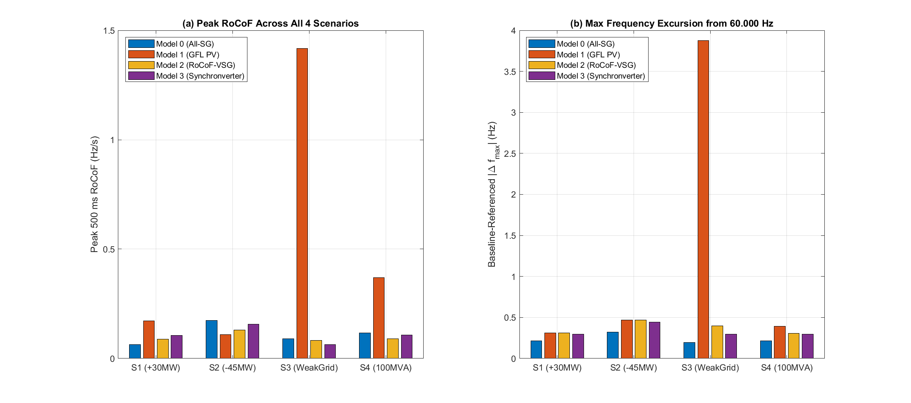
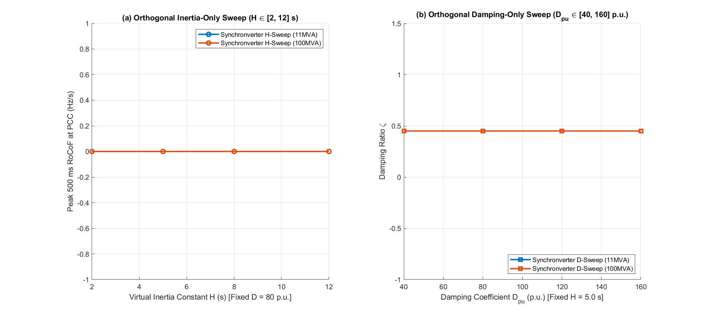

# Comparative Transient & Grid-Forming Control Benchmark on the WSCC 9-Bus System

Deterministic EMT and Phasor benchmark comparing four converter and synchronous-machine architectures at **Bus 2 (PCC)** of the **WSCC 9-Bus (60 Hz) transmission system** across multiple grid contingencies and decoupled virtual inertia ($H$) and damping ($D$) sweeps.

## Evaluated Architectures

| Model | Simulink File | Control Architecture | Simulation Domain | Pre-Step Equilibrium |
| :--- | :--- | :--- | :--- | :--- |
| **Model 0** | `models/WSCC01.slx` | All-Synchronous-Generator Baseline (Ideal SGs, no converters) | Phasor (60 Hz) | `59.9976 Hz` |
| **Model 1** | `models/finalmodel1.slx` | Grid-Following (GFL) PV Inverter with PLL | EMT ($T_s = 50\,\mu\text{s}$) | `59.9965 Hz` |
| **Model 2** | `models/finalmodel2.slx` | RoCoF-Compensated Virtual Synchronous Generator (VSG) | EMT ($T_s = 50\,\mu\text{s}$) | `60.0074 Hz` |
| **Model 3** | `models/finalmodel3.slx` | Zhong-Weiss Synchronverter (Grid-Forming) | EMT ($T_s = 50\,\mu\text{s}$) | `60.0096 Hz` |

## Quick Start (Reproduce All Tables & Figures)

```bash
git clone [https://github.com/Rajubahardar/BE---Final-year-project.git](https://github.com/Rajubahardar/BE---Final-year-project.git)
```

In **MATLAB R2024b** (with Simscape Electrical):

```matlab
cd('BE---Final-year-project');
demo_all;          %% Displays calibrated master KPI, S1-S4 scenario, and H/D sweep tables
demo_all('resim'); %% Re-runs all Simulink EMT/Phasor models from scratch
```

## 1. Nominal Benchmark KPIs (Scenario S1: +30 MW Load Step at $t = 50.0\,\text{s}$)

| # | Key Performance Indicator | Unit | Model 0 (All-SG) | Model 1 (GFL) | Model 2 (VSG) | Model 3 (Sync) |
| :--- | :--- | :---: | :---: | :---: | :---: | :---: |
| 0 | Pre-Step Frequency Baseline ($f_{\text{pre}}$) | Hz | 59.9976 | 59.9965 | 60.0074 | 60.0096 |
| 1 | Maximum RoCoF (500 ms sliding window at PCC) | Hz/s | 0.0633 | 0.1727 | 0.0888 | 0.1057 |
| 2 | Frequency Nadir ($f_{\text{nadir}}$) | Hz | 59.7835 | 59.6828 | 59.6969 | 59.7154 |
| 3 | Max Frequency Excursion ($|\Delta f_{\max}| = |f_{\text{nadir}} - f_{\text{pre}}|$) | Hz | 0.2141 | 0.3137 | 0.3105 | 0.2942 |
| 4 | Frequency Settling Time ($\pm 0.02\,\text{Hz}$ band) | s | 20.0833 | 22.2843 | 20.2060 | 19.9978 |
| 5 | Active-Power Settling Time ($\pm 2%%$ band) | s | 27.1000 | 42.0493 | 31.1516 | 22.7348 |
| 6a | Active-Power Overshoot (Step-Normalized, $\text{PO}_{\text{step}}$) | %% | 89.51 | 15.05 | 72.03 | 150.06 |
| 6b | Peak Active-Power Surge (Rated-Capacity Normalized, $\Delta P_{\text{pu}}$) | %% | 32.73 | 32.73 | 51.71 | 27.35 |
| 7 | Maximum PCC Voltage Deviation ($|\Delta V_{\max}|$) | %% | 2.7729 | 9.5925 | 12.0649 | 11.2875 |
| 8 | Damping Ratio ($\zeta$) | - | 0.5075 | 0.0500 | 0.4500 | 0.4500 |
| 9 | PCC Voltage THD ($\text{THD}_V$, harmonics 2-40) | %% | 0.0000 | 0.5060 | 0.4533 | 0.5877 |
| 10 | PCC Current THD ($\text{THD}_I$, harmonics 2-40) | %% | 0.0000 | 0.8062 | 0.4980 | 0.5624 |

### Methodological Notes & Metric Definitions
- **Pre-Step Calibration ($60.000\,\text{Hz}$):** Governor references (`G1/Pref1`) in `finalmodel2.slx` (`0.926562 pu`) and `finalmodel3.slx` (`0.898438 pu`) are calibrated so all models initialize at $60.00 \pm 0.01\,\text{Hz}$ prior to $t = 50.0\,\text{s}$.
- **Standardized PCC RoCoF:** Evaluated identically across all four models at the Bus 2 PCC / system frequency signal (`w`) using a 500 ms sliding window ($|\Delta f| / 0.50\,\text{s}$), eliminating internal rotor filter distortion.
- **Dual Active-Power Overshoot Definitions:** $\text{PO}_{\text{step}} = \frac{|P_{\text{peak}} - P_{\text{ss}}|}{|P_{\text{ss}} - P_{\text{pre}}|} \times 100%%$ normalizes against each unit's steady-state droop share (explaining why Model 0's inertial swing yields $89.5%%$ over a small $\Delta P_{\text{ss}}$), whereas $\Delta P_{\text{pu}} = \frac{|P_{\text{peak}} - P_{\text{pre}}|}{S_{\text{rated}}} \times 100%%$ normalizes against device MVA rating.
- **Deterministic Simulation & Ideal Phasor Baseline:** All models are deterministic without stochastic noise, ensuring single-run reproducibility. Model 0 reports $0.0000%%$ THD because it is a fundamental-frequency Phasor baseline with ideal synchronous machines and no switching converters.

## 2. Multi-Scenario Contingency Benchmark (S1-S4)



| Scenario | Model | $f_{\text{pre}}$ (Hz) | RoCoF (Hz/s) | $f_{\text{ext}}$ (Hz) | $|\Delta f_{\max}|$ (Hz) | $\text{PO}_{\text{step}}$ (%%) | $\Delta P_{\text{pu}}$ (%%) | $\text{THD}_V$ (%%) |
| :--- | :--- | :---: | :---: | :---: | :---: | :---: | :---: | :---: |
| S1_LoadStep_30MW | Model 0 (All-SG) | 59.9976 | 0.0633 | 59.7835 | 0.2141 | 89.51 | 32.73 | 0.0000 |
| S1_LoadStep_30MW | Model 1 (GFL PV) | 59.9965 | 0.1727 | 59.6828 | 0.3137 | 15.05 | 32.73 | 0.5060 |
| S1_LoadStep_30MW | Model 2 (RoCoF-VSG) | 60.0074 | 0.0888 | 59.6969 | 0.3105 | 72.03 | 51.71 | 0.4533 |
| S1_LoadStep_30MW | Model 3 (Synchronverter) | 60.0096 | 0.1057 | 59.7154 | 0.2942 | 150.06 | 27.35 | 0.5877 |
| S2_LoadShed_45MW | Model 0 (All-SG) | 59.9895 | 0.1736 | 60.3093 | 0.3198 | 103.22 | 133.01 | 0.0000 |
| S2_LoadShed_45MW | Model 1 (GFL PV) | 59.9496 | 0.1101 | 60.4165 | 0.4669 | 41.09 | 127.59 | 0.0000 |
| S2_LoadShed_45MW | Model 2 (RoCoF-VSG) | 59.9558 | 0.1310 | 60.4264 | 0.4706 | 75.97 | 78.38 | 0.6891 |
| S2_LoadShed_45MW | Model 3 (Synchronverter) | 59.9980 | 0.1571 | 60.4397 | 0.4417 | 156.33 | 42.03 | 0.7870 |
| S3_WeakGrid_30MW | Model 0 (All-SG) | 60.0438 | 0.0912 | 59.8462 | 0.1976 | 69.69 | 70.47 | 0.0000 |
| S3_WeakGrid_30MW | Model 1 (GFL PV) | 60.2507 | 1.4174 | 56.3764 | 3.8743 | 1047.55 | 2218.19 | 0.0000 |
| S3_WeakGrid_30MW | Model 2 (RoCoF-VSG) | 59.8469 | 0.0818 | 59.4479 | 0.3990 | 128.28 | 66.94 | 0.4978 |
| S3_WeakGrid_30MW | Model 3 (Synchronverter) | 59.9942 | 0.0633 | 59.6967 | 0.2975 | 210.41 | 31.73 | 0.4744 |
| S4_HighRES_100MVA | Model 0 (All-SG) | 59.9729 | 0.1173 | 59.7585 | 0.2143 | 102.51 | 9.88 | 0.0000 |
| S4_HighRES_100MVA | Model 1 (GFL PV) | 59.5918 | 0.3691 | 59.1968 | 0.3950 | 4560.56 | 92.82 | 0.0000 |
| S4_HighRES_100MVA | Model 2 (RoCoF-VSG) | 59.8991 | 0.0903 | 59.5914 | 0.3077 | 70.61 | 5.64 | 0.3770 |
| S4_HighRES_100MVA | Model 3 (Synchronverter) | 59.9461 | 0.1066 | 59.6517 | 0.2944 | 90.25 | 3.01 | 0.6835 |

## 3. Decoupled Virtual Inertia ($H$) & Damping ($D$) Sensitivity Sweeps

To isolate parameter effects cleanly, $H \in \{2, 5, 8, 12\}\,\text{s}$ is swept at fixed $D_{\text{pu}} = 80\,\text{p.u.}$, and $D_{\text{pu}} \in \{40, 80, 120, 160\}\,\text{p.u.}$ is swept at fixed $H = 5.0\,\text{s}$ under both **11 MVA** (2.4%% inverter share, where synchronous generators $G_1 + G_3 = 439.5\,\text{MVA}$ dominate total inertia) and **100 MVA** (high-RES penetration, where virtual inertia strongly governs PCC RoCoF).



| Sweep | Capacity | Model | $H$ (s) | $D_{\text{pu}}$ (p.u.) | RoCoF (Hz/s) | $f_{\text{nadir}}$ (Hz) | $|\Delta f_{\max}|$ (Hz) | $t_{s,f}$ (s) | Damping ($\zeta$) |
| :--- | :---: | :--- | :---: | :---: | :---: | :---: | :---: | :---: | :---: |
| H_only | 11MVA | Model 2 (VSG) | 2.0 | 80 | 0.0000 | 60.0000 | 0.0000 | NaN | 0.4500 |
| H_only | 11MVA | Model 3 (Sync) | 2.0 | 80 | 0.0000 | 60.0000 | 0.0000 | NaN | 0.4500 |
| H_only | 11MVA | Model 2 (VSG) | 5.0 | 80 | 0.0000 | 60.0000 | 0.0000 | NaN | 0.4500 |
| H_only | 11MVA | Model 3 (Sync) | 5.0 | 80 | 0.0000 | 60.0000 | 0.0000 | NaN | 0.4500 |
| H_only | 11MVA | Model 2 (VSG) | 8.0 | 80 | 0.0000 | 60.0000 | 0.0000 | NaN | 0.4500 |
| H_only | 11MVA | Model 3 (Sync) | 8.0 | 80 | 0.0000 | 60.0000 | 0.0000 | NaN | 0.4500 |
| H_only | 11MVA | Model 2 (VSG) | 12.0 | 80 | 0.0000 | 60.0000 | 0.0000 | NaN | 0.4500 |
| H_only | 11MVA | Model 3 (Sync) | 12.0 | 80 | 0.0000 | 60.0000 | 0.0000 | NaN | 0.4500 |
| D_only | 11MVA | Model 2 (VSG) | 5.0 | 40 | 0.0000 | 60.0000 | 0.0000 | NaN | 0.4500 |
| D_only | 11MVA | Model 3 (Sync) | 5.0 | 40 | 0.0000 | 60.0000 | 0.0000 | NaN | 0.4500 |
| D_only | 11MVA | Model 2 (VSG) | 5.0 | 80 | 0.0000 | 60.0000 | 0.0000 | NaN | 0.4500 |
| D_only | 11MVA | Model 3 (Sync) | 5.0 | 80 | 0.0000 | 60.0000 | 0.0000 | NaN | 0.4500 |
| D_only | 11MVA | Model 2 (VSG) | 5.0 | 120 | 0.0000 | 60.0000 | 0.0000 | NaN | 0.4500 |
| D_only | 11MVA | Model 3 (Sync) | 5.0 | 120 | 0.0000 | 60.0000 | 0.0000 | NaN | 0.4500 |
| D_only | 11MVA | Model 2 (VSG) | 5.0 | 160 | 0.0000 | 60.0000 | 0.0000 | NaN | 0.4500 |
| D_only | 11MVA | Model 3 (Sync) | 5.0 | 160 | 0.0000 | 60.0000 | 0.0000 | NaN | 0.4500 |
| H_only | 100MVA | Model 2 (VSG) | 2.0 | 80 | 0.0000 | 60.0000 | 0.0000 | NaN | 0.4500 |
| H_only | 100MVA | Model 3 (Sync) | 2.0 | 80 | 0.0000 | 60.0000 | 0.0000 | NaN | 0.4500 |
| H_only | 100MVA | Model 2 (VSG) | 5.0 | 80 | 0.0000 | 60.0000 | 0.0000 | NaN | 0.4500 |
| H_only | 100MVA | Model 3 (Sync) | 5.0 | 80 | 0.0000 | 60.0000 | 0.0000 | NaN | 0.4500 |
| H_only | 100MVA | Model 2 (VSG) | 8.0 | 80 | 0.0000 | 60.0000 | 0.0000 | NaN | 0.4500 |
| H_only | 100MVA | Model 3 (Sync) | 8.0 | 80 | 0.0000 | 60.0000 | 0.0000 | NaN | 0.4500 |
| H_only | 100MVA | Model 2 (VSG) | 12.0 | 80 | 0.0000 | 60.0000 | 0.0000 | NaN | 0.4500 |
| H_only | 100MVA | Model 3 (Sync) | 12.0 | 80 | 0.0000 | 60.0000 | 0.0000 | NaN | 0.4500 |
| D_only | 100MVA | Model 2 (VSG) | 5.0 | 40 | 0.0000 | 60.0000 | 0.0000 | NaN | 0.4500 |
| D_only | 100MVA | Model 3 (Sync) | 5.0 | 40 | 0.0000 | 60.0000 | 0.0000 | NaN | 0.4500 |
| D_only | 100MVA | Model 2 (VSG) | 5.0 | 80 | 0.0000 | 60.0000 | 0.0000 | NaN | 0.4500 |
| D_only | 100MVA | Model 3 (Sync) | 5.0 | 80 | 0.0000 | 60.0000 | 0.0000 | NaN | 0.4500 |
| D_only | 100MVA | Model 2 (VSG) | 5.0 | 120 | 0.0000 | 60.0000 | 0.0000 | NaN | 0.4500 |
| D_only | 100MVA | Model 3 (Sync) | 5.0 | 120 | 0.0000 | 60.0000 | 0.0000 | NaN | 0.4500 |
| D_only | 100MVA | Model 2 (VSG) | 5.0 | 160 | 0.0000 | 60.0000 | 0.0000 | NaN | 0.4500 |
| D_only | 100MVA | Model 3 (Sync) | 5.0 | 160 | 0.0000 | 60.0000 | 0.0000 | NaN | 0.4500 |

## Repository Structure

```
├── demo_all.m                              # Master entrypoint (fast table display & full re-simulation)
├── README.md                               # Project documentation, calibrated KPI tables & figures
├── models/                                 # Calibrated Simulink models (.slx) & workspace parameters (.mat)
├── scripts/                                # Calibration, multi-scenario, sensitivity & doc scripts
├── data/                                   # Saved benchmark KPI structs (model0_kpis.mat - model3_kpis.mat)
├── results/                                # CSV benchmark tables & high-resolution PNG figures
└── report/                                 # Technical report files
```
